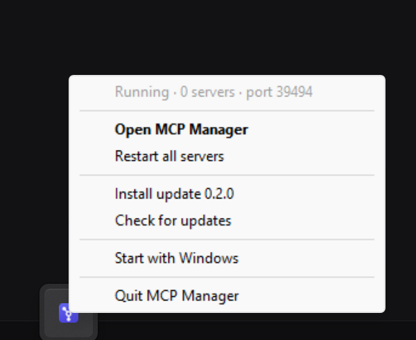
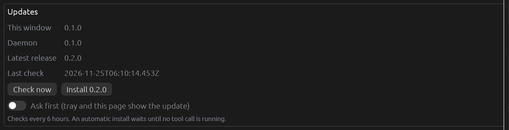
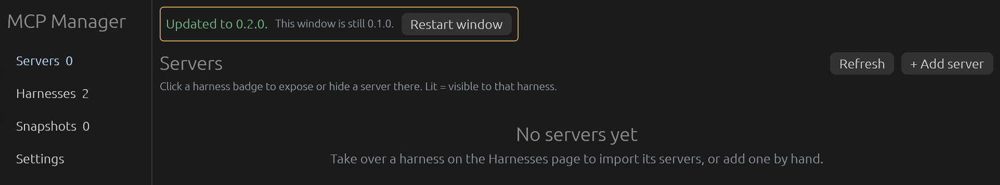

# MCP Manager

One small Windows app that manages the MCP servers of every AI tool on your PC. It becomes the
only MCP entry in each tool (Claude Code, Claude Desktop, Codex, Cursor, VS Code, OpenCode,
Gemini CLI, Windsurf, Antigravity), runs the servers it took over once, and can put every
config file back exactly as it was.

- One exe, no installer, no web tech. The background daemon idles under ~10 MB.
- Every config write is snapshotted first. Restore is always one command away.
- A tray icon shows the daemon is up and opens the window.
- It updates itself from GitHub releases.

## Install

1. Download `mcpm.exe` from the [latest release](https://github.com/watdafawx/mcp-manager/releases/latest).
2. Put it anywhere you like (for example `%LOCALAPPDATA%\Programs\mcpm\`). Nothing else is installed.

Windows may show a SmartScreen warning for an unsigned exe the first time: **More info**, then **Run anyway**.

## Quick start

```
mcpm                              # opens the window (starts the daemon if needed)
mcpm takeover --all --dry-run     # shows what would change in every detected tool, writes nothing
mcpm takeover --all               # does it, after snapshotting every file it touches
mcpm restore --all                # puts every tool's config back
mcpm autostart on                 # start the daemon when you sign in
```

Run `mcpm` from a terminal and add `--help` to any command for the rest: `status`, `harnesses`,
`servers`, `snapshots`, `restore`, `uninstall`.

`mcpm uninstall` restores every tool, removes autostart and stops the daemon. Your snapshots and
`config.json` stay in `%APPDATA%\mcpm` until you delete them.

## Tray icon

While the daemon runs, a notification-area icon shows its state. Double-click it to open the
window. The right-click menu has:

- the status line (running, how many servers, port)
- **Open MCP Manager**
- **Restart all servers**
- **Check for updates**, and **Install update x.y.z** once one is found
- **Start with Windows** (checkbox)
- **Quit MCP Manager**

`mcpm daemon --no-tray` runs without the icon.



## Updates

The daemon asks GitHub for the latest release 20 seconds after it starts and every 6 hours. A
newer `mcpm.exe` is downloaded, checked against the release's SHA-256, and swapped in when no
tool call is running. The daemon restarts itself, and an open window offers **Restart window**.

- **Settings** in the window, or `mcpm update --check`, shows what is available.
- Turn **Install updates automatically** off to be asked first (tray, window, `mcpm update`).
- `mcpm update` installs by hand.





## Building from source

```
cargo build --release -p mcpm      # target\release\mcpm.exe
cargo test --workspace
```

How it works: [SPEC.md](SPEC.md). Cutting a release: [docs/release.md](docs/release.md).

## License

MIT
